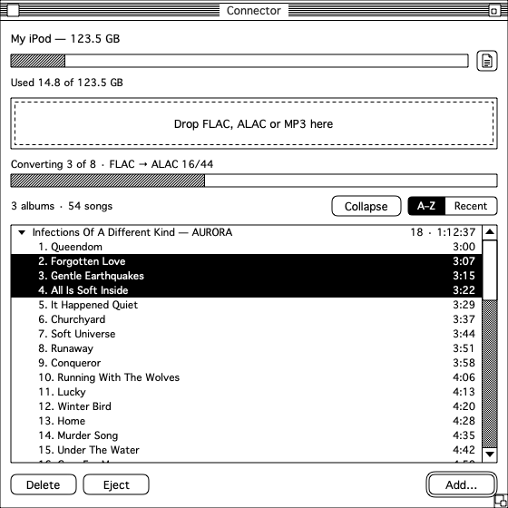

# Connector

A minimalist iTunes replacement for managing an **iPod Classic running Apple's original firmware** from a modern Mac. Drag songs, albums or folders onto the window and they end up on the iPod. Classic Mac System 7 look and feel.



It is not a player or a library manager: it is a bridge between files on your disk and the iPod.

## What it does

- Adds music by drag and drop (or with **Add…**), without syncing your whole library. Dropping more while a batch is running queues it.
- Converts everything lossless (FLAC, ALAC, WAV, AIFF) on your Mac to **ALAC 16-bit / 44.1 kHz**, including high-resolution sources. MP3 and AAC are copied as they are. Nothing is converted on another machine: files are read from wherever they are (for example, a network volume) and transformed locally.
- Shows the iPod's contents as a nested list: each album with its songs indented below it, sorted A–Z by default or by most recently added. Albums can be collapsed and expanded.
- Deletes songs or whole albums.
- Syncs cover art (the embedded one or, if there is none, `cover.jpg`, `folder.jpg` or `front.jpg` from the folder).
- Keeps a log of the last batch (reading, converting, copying, saving, added, duplicate, failed, deleted) that you can copy.
- Ejects the iPod safely.

Out of scope for now: playlists, audio playback, podcasts, video, other iPod models and iPods running Rockbox.

## iPod Classic with Apple firmware only

Connector writes the iPod's database (`iTunesDB`, `ArtworkDB`) and signs it with the device's FireWire identifier. It does not work with other models (Nano, Shuffle, Touch) or with iPods running Rockbox, which does not need this app.

Connector is not affiliated with or endorsed by Apple Inc. iPod and iTunes are trademarks of Apple Inc.

## Installation

1. Download `Connector-<version>.dmg` from [Releases](https://github.com/NicolasTobias/Connector/releases).
2. Open the `.dmg` and drag **Connector** to **Applications**.

### First launch (unsigned app)

The app is not signed or notarized by Apple, so macOS blocks it the first time:

1. Try to open Connector. macOS will say it cannot verify that it is free of malware.
2. Go to **System Settings → Privacy & Security**, scroll to the Connector notice and click **Open Anyway**.
3. Confirm with your password. From then on it opens normally.

## Usage

1. Put the iPod in disk mode and connect it. It should appear as a volume in Finder, containing the `iPod_Control` folder.
2. Open Connector: it detects the iPod, shows its name and lists its contents.
3. Drag files or folders onto the drop zone, or click **Add…**.
4. To delete, select songs (or an album) and click **Delete** (it asks for confirmation).
5. Click **Eject** before unplugging.

Supported formats: FLAC, ALAC (`.m4a`), WAV, AIFF, MP3 and AAC (`.m4a`). Anything else is rejected with a message.

## Backups

Before every write, `iTunesDB`, `ArtworkDB` and `Play Counts` are saved to:

```
~/Library/Application Support/Connector/Backups/<iPod GUID>/<date-time>/
```

The first time Connector writes to an iPod it also saves an `inicial/` copy of `iPod_Control` without the music. The last 20 backups are kept. Writes are atomic: if anything fails halfway, the iPod's database is left as it was, and Connector refuses to write if the database changed while it was converting.

## Building

Requires macOS 14 or later on Apple Silicon and Swift 6 (the Command Line Tools are enough). No external dependencies.

```bash
swift run connector-tests       # tests (custom runner)
swift run Connector             # launch the app
swift run connector-cli info    # command-line tool for the iPod
scripts/build-app.sh            # dist/Connector.app
scripts/make-dmg.sh             # dist/Connector-<version>.dmg
```

The tests do not use XCTest or swift-testing. Some tests are skipped unless `CONNECTOR_REAL_IPOD_CONTROL` (path to a copy of `iPod_Control`, obtained with `connector-cli export-control <dir>`) and `CONNECTOR_REAL_GUID` are set.

### Publishing a release

The `Release` workflow runs when a `v*` tag is pushed whose number matches `connectorVersion`. It runs the tests, builds the `.dmg` and uploads it to GitHub Releases. To sign and notarize once there is an Apple Developer account, define the secrets `CONNECTOR_SIGN_IDENTITY`, `CONNECTOR_CERT_P12`, `CONNECTOR_CERT_PASSWORD`, `CONNECTOR_NOTARY_APPLE_ID`, `CONNECTOR_NOTARY_TEAM_ID` and `CONNECTOR_NOTARY_PASSWORD`. That signing path has not been tested yet.

## Typography

The interface uses Geneva, from the system. To use a Chicago-style font instead, install it (for example with Font Book) and set the preference:

```bash
defaults write io.github.nicolastobias.connector TitleFont ChicagoFLF   # installed app
swift run Connector -TitleFont ChicagoFLF                                # from source
```

The font is not bundled because its license has not been verified. If you bundle one, put its license in `LICENSES/`.

## Support

Connector is free and open source. If it saved you from a heavy music app and you'd like to say thanks, you can [buy me a coffee](https://buymeacoffee.com/level5). It is entirely optional.

## Contributing

Issues and pull requests are welcome. Please run `swift run connector-tests` before sending a change. The format code is deliberately conservative: it must never corrupt an iPod's database, so changes there should come with tests, ideally against a real `iPod_Control` copy.

## License and credits

Connector is released under the MIT License (see `LICENSE`).

The iPod database format was learned from [libgpod](https://github.com/gtkpod/libgpod), which was used only as a reference to read. The `hash58` signature is a port of `itdb_hash58.c` (3-clause BSD); its notice is in `LICENSES/libgpod-hash58-BSD.txt` and in `Sources/ConnectorCore/IPodDB/Hash58.swift`.
